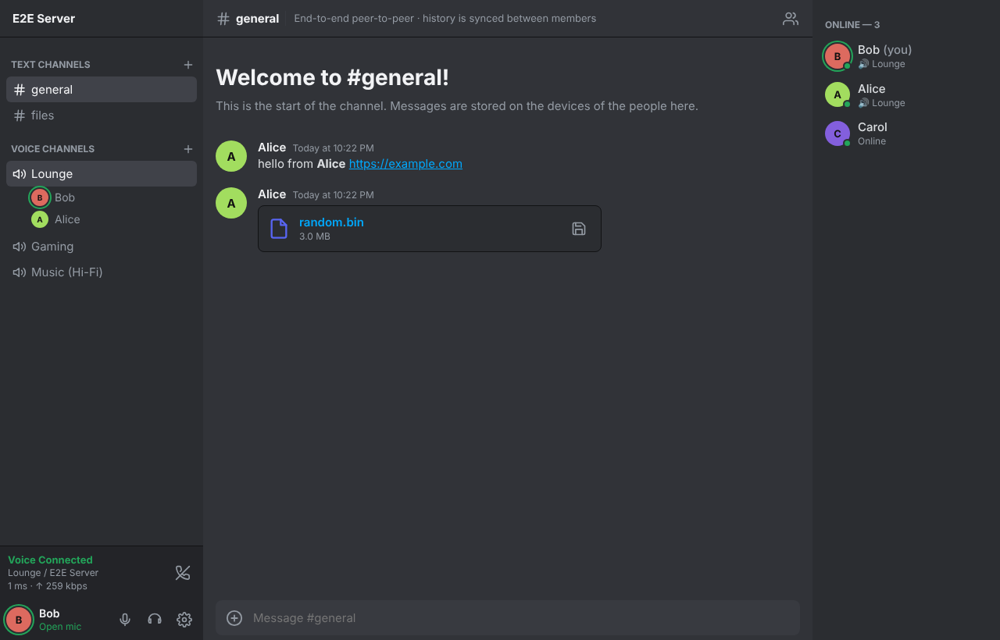

# Voice

An open source, peer-to-peer Discord/TeamSpeak alternative for **Windows, macOS and Linux**, built for audio quality first:

- **Opus with low latency.** 10 ms frames by default, up to 510 kbps (the Opus maximum), full-band 48 kHz stereo, with in-band FEC. Each user controls the quality they send.
- **Peer-to-peer.** Voice, chat messages and files go **directly between users** over encrypted WebRTC (DTLS-SRTP and SCTP). No media server sits in the audio path.
- **Text channels with history.** Each client stores the history locally and fills in what it missed from the other peers when it connects.
- **File sharing.** Drag and drop, paste or attach files of any size. They stream peer-to-peer, and everyone who downloads a file can then serve it to others. Images, audio and video show inline previews.
- **Voice channels** in the style of TeamSpeak. Includes push-to-talk (works globally, even inside games), voice activation with a visual threshold, per-user volume, mute/deafen, speaking indicators and live connection stats (ping, bitrate, loss, jitter buffer).
- **Hosting is one click.** Start a server inside the app, or run the small standalone server on a VPS or Raspberry Pi.



## How it works

```
        ┌──────────────────────────────┐
        │   Signaling server (tiny)    │  presence, channel list, WebRTC handshakes
        └───▲────────────▲─────────▲───┘  (never sees audio, messages or files)
            │ WebSocket  │         │
     ┌──────┴───┐   ┌────┴─────┐  ┌┴─────────┐
     │  Alice   │◄─►│   Bob    │◄►│  Carol   │  full mesh of direct WebRTC connections:
     └────▲─────┘   └──────────┘  └────▲─────┘  Opus audio + chat + file data channels
          └────────────────────────────┘
```

Peers can't find each other on the internet without help, so a small **signaling server** handles discovery: who is online, which voice channel each person is in, the channel list, and relaying the WebRTC connection setup. After that, every pair of users is connected **directly**. Any user can host the signaling server from inside the app, the way people host a TeamSpeak server.

Each pair of users shares one `RTCPeerConnection` with:

| Stream | Transport | Notes |
|---|---|---|
| Voice | Opus over SRTP | Only fed with your microphone while you're both in the same voice channel (`replaceTrack`). Switching channels is instant, with no renegotiation and no bandwidth when idle. |
| Chat | Reliable SCTP data channel | Messages, history sync, typing indicators. |
| Files | Reliable SCTP data channel | 64 KB binary chunks with back-pressure. |

The full mesh is ideal for groups up to roughly 10–15 people talking in one channel, which is the usual size for gaming or friend groups. Each speaker uploads one stream per listener: 15 listeners × 128 kbps ≈ 2 Mbit/s upload.

### Audio pipeline and latency

| Stage | Setting | Effect |
|---|---|---|
| Capture | `getUserMedia` 48 kHz, `latency: 0`. Echo cancellation, noise suppression and AGC can each be turned off. | With all processing off ("Hi-Fi" preset) you get raw stereo capture. |
| Send path | Mic track goes **straight into WebRTC**. VAD and meters run on a cloned track. | No WebAudio buffering in the send path. |
| Encoder | Opus, `ptime=10`/`minptime=10`, `maxaveragebitrate` up to 510000, `stereo=1`, `useinbandfec=1`, `usedtx=0` | 10 ms frames are the minimum WebRTC supports, half the usual 20 ms. |
| Network | Direct UDP between peers. RTP priority is set to `high` (DSCP marking). | No server hop. |
| Receiver | `jitterBufferTarget = 0` (configurable) | The jitter buffer stays as small as the network allows. |

The Opus encoder is configured from the fmtp parameters the **remote** side advertises. Voice therefore rewrites SDP in both directions:

- Your local description tells peers "send me up to 510 kbps stereo".
- Before applying a peer's description, Voice rewrites it with **your** send settings, so your encoder uses exactly the bitrate, frame size, stereo and FEC you chose.

Changes apply live through renegotiation. The code is in [`src/renderer/js/opus.js`](src/renderer/js/opus.js).

The automated end-to-end test checks this on real connections: about **100 packets/s** (10 ms frames), **256 kbps stereo** received, and live bitrate changes taking effect.

Recommended quality presets (Settings → Opus Quality):

| Preset | Processing | Bitrate | Use |
|---|---|---|---|
| Voice chat | Echo cancellation and noise suppression on | 128 kbps mono | Speakers or laptop microphones |
| Hi-Fi / Music | All off | 510 kbps stereo | Headphones, instruments, streaming music |
| Bad connection | On | 64 kbps mono, 20 ms frames | Weak Wi-Fi or mobile hotspots |

> Echo cancellation in Chromium forces mono capture. Turn it off and wear headphones to send stereo.

## Getting started

### Download

Installers for Windows (`.exe`), macOS (`.dmg`) and Linux (`.AppImage` / `.deb`) are built by GitHub Actions. Push a tag like `v0.1.0` and they are attached to the GitHub release. Builds from `main` are available as workflow artifacts.

> The builds are unsigned. On Windows, click "More info → Run anyway" in SmartScreen. On macOS, right-click the app → Open the first time.

### Run from source

```bash
npm install
npm start
```

Requires Node.js 20+.

### Host a server

**From the app.** On the start screen, choose "Host a server". Other people on your network connect to the LAN address shown under the server name.

**Over the internet.** Forward **TCP port 9987** (or your chosen port) on your router to the hosting PC and share your public IP. Only the signaling connection uses this port; voice, chat and files connect directly, using STUN to get through NAT.

**Standalone server**, for a VPS, a Raspberry Pi or Docker, so the server stays up without anyone's PC running:

```bash
node server/index.js --port 9987 --name "My Server" --password secret
# or
docker build -t voice-server .
docker run -d -p 9987:9987 -e VOICE_PASSWORD=secret -v voice-data:/data voice-server
```

Run `node server/index.js --help` for all options, including `--turn-url/--turn-user/--turn-pass`, which push a TURN relay to every client.

**Using TLS.** Put the server behind a reverse proxy (Caddy, nginx) and connect with `wss://voice.example.com`.

### Strict NATs and TURN

Most home connections can connect directly. If two users are both behind strict or symmetric NAT (some mobile carriers, corporate networks), a direct path may be impossible. Run a TURN relay such as [coturn](https://github.com/coturn/coturn) and either:

- add it under **Settings → Network**, or
- start the standalone server with `--turn-url`.

The member popover shows whether a connection is `direct (P2P)` or `relay (TURN)`.

## Features in detail

- **Push-to-talk:** any key or mouse button (Mouse 4/5 work). It is global thanks to [`uiohook-napi`](https://github.com/SnosMe/uiohook-napi); on macOS, allow Voice under *Privacy & Security → Accessibility*. On Linux, global hotkeys need an X11 session; on Wayland, push-to-talk works while the Voice window is focused. You can set a release delay so your last word isn't cut off.
- **Voice activation:** a live meter with a threshold marker and a 300 ms hold time.
- **Hear yourself:** a mic loopback test in the audio settings.
- **Per-user volume and "mute for me":** click a user. The same popover shows round trip time, send and receive bitrate, packet loss, jitter, jitter buffer delay, the negotiated codec and the encoder fmtp.
- **Shortcuts:** `Ctrl/⌘+Shift+M` mute, `Ctrl/⌘+Shift+D` deafen, `Enter` send, `Shift+Enter` new line.
- **Chat:** `**bold**`, `` `code` ``, fenced code blocks, links, `@mentions` (highlighted, with desktop notifications), and typing indicators.
- **Files:** drag and drop, paste screenshots, or use the ⊕ button. Images, audio and video under 25 MB download automatically for inline preview; larger files download on click. Files up to 200 MB are cached locally, so you can keep sharing them after a restart.
- **Multiple identities on one machine:** `npm start -- --profile=second` (useful for testing).

## Security and privacy model

- All peer traffic is encrypted by WebRTC (DTLS-SRTP for audio, DTLS for data channels).
- The signaling server sees names, presence and connection metadata (IP addresses, SDP). It never sees audio, chat or files.
- Peers in a P2P app see each other's IP addresses, just as with TeamSpeak hosted by a friend.
- Plain `ws://` signaling is unauthenticated transport. Anyone who can tamper with it could intercept a connection setup, so use `wss://` (TLS) on untrusted networks.
- Chat identity is a random per-install ID. Live messages are tied to the peer that sent them, but history synced from other peers is trusted as-is. Signed messages are on the roadmap.
- The Electron renderer runs sandboxed with context isolation and a strict CSP. Links open in your browser.

## Development

```
src/
  main/          Electron main process (window, embedded server, global PTT)
  server/        Signaling server (used embedded and standalone)
  renderer/
    index.html, styles.css
    js/app.js            UI and orchestration
    js/mesh.js           WebRTC full mesh, perfect negotiation, routing, stats
    js/opus.js           Opus SDP tuning
    js/audio.js          Mic capture, VAD, PTT, UI sounds
    js/files.js          P2P file transfer
    js/store.js          IndexedDB history and file cache
    js/signaling-client.js
server/index.js  Standalone server CLI
test/            Unit tests (node:test) + e2e test (two real app instances)
```

```bash
npm test                      # unit tests: SDP tuning, signaling server
xvfb-run -a npm run test:e2e  # two Electron clients: P2P connect, chat, Opus 10 ms/256 kbps, file transfer, history sync
npm run dist                  # package for the current OS into dist/
```

## Roadmap ideas

- Screen sharing and video
- Signed messages (per-user key pairs)
- An SFU mode for very large channels
- Server roles and permissions
- Direct messages

## License

GPL-3.0. See [LICENSE](LICENSE).
